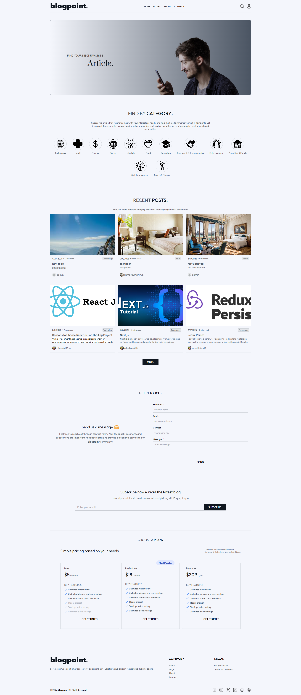
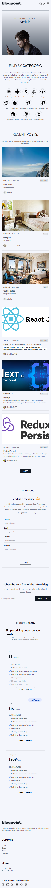
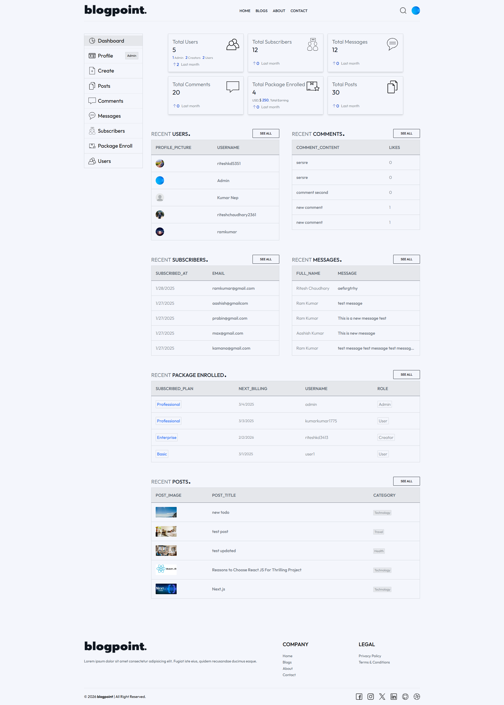
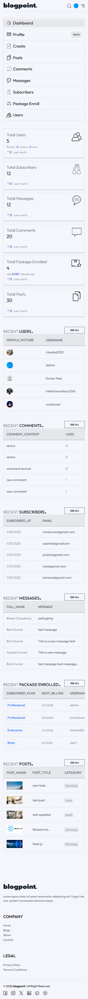
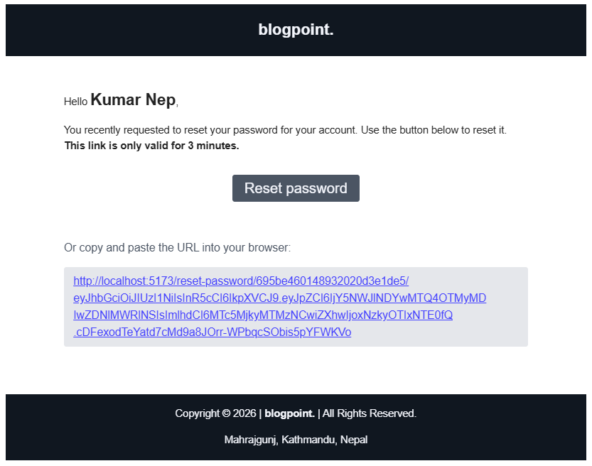

# BlogPoint – MERN Stack Blog Application

### NOTE:

- FUll documentation of this project in pdf format file named as "document/blogpoint-document.pdf".

BlogPoint is a full-stack **MERN Stack blog application** where users can create accounts, read and interact with blog posts, while creators can publish and manage content. Administrators have access to a dashboard for managing users, posts, comments, messages, subscribers, and subscription payments.

The application also includes authentication, password recovery through email, image uploads, Google login, and PayPal subscription functionality.

**Live Application:** [BlogPoint App](https://blogpoint-yw3m.onrender.com)

## Features

- User registration and login
- Secure password hashing with **bcryptjs**
- Google authentication
- JWT-based authentication with secure cookies
- HTTP-only authentication cookies
- Forgot password and password reset through email
- Protected routes
- User profile management
- Profile image upload
- MongoDB database integration
- Role-based access for **User, Creator, and Admin**
- Create, update, and delete blog posts
- Rich text editor for blog content
- Blog categories and search
- Comments and comment likes
- Contact/message system
- Newsletter subscription
- Creator dashboard
- Admin dashboard
- User and content management
- Cloudinary image storage
- PayPal subscription plans
- Subscription and payment information
- Responsive user interface with Tailwind CSS
- Production deployment with Render

## Technology Stack

### Frontend

- React.js
- Vite
- React Router
- Redux Toolkit
- Redux Persist
- Tailwind CSS
- React Quill
- React Icons
- React Share
- React Hot Toast
- Firebase Authentication

### Backend

- Node.js
- Express.js
- MongoDB
- Mongoose
- JSON Web Token (JWT)
- Cookie Parser
- bcryptjs
- Nodemailer
- Multer
- Cloudinary

### Payment

- PayPal

### Deployment

- GitHub
- Render

## How the Application Works

The application follows a typical full-stack architecture:

```text
React Frontend
      ↓
Express REST API
      ↓
MongoDB Database
      ↓
External Services
 ├── Cloudinary
 ├── Nodemailer
 ├── Firebase
 └── PayPal
```

Users interact with the React frontend, which communicates with the Express backend through REST APIs. The backend handles authentication, authorization, business logic, database operations, image uploads, emails, and payments.

## User Roles

### User

- Register and sign in
- View blog posts
- Comment and like comments
- Manage profile
- Subscribe to a plan

### Creator

- Everything available to a regular user
- Create blog posts
- Update and delete own posts
- View comments on own posts
- Access creator dashboard

### Admin

- Manage users
- Manage all blog posts
- Manage comments
- Manage contact messages
- Manage subscribers
- View subscription records
- View dashboard statistics
- Manage user roles

## Authentication

BlogPoint uses JWT authentication with HTTP-only cookies.

Authentication includes:

- Signup
- Signin
- Google login
- Signout
- Password hashing with bcrypt
- Forgot password
- Password reset with temporary token
- Protected API routes
- Role-based authorization

Password reset tokens expire after a short period for security.

## Blog Management

Creators can create blog posts using a rich text editor.

Each post can contain:

- Title
- Featured image
- Category
- Rich text content
- Creator information
- Created and updated dates
- SEO-friendly slug

Posts can be searched, filtered by category, sorted, and displayed with related content.

## Dashboard

The dashboard provides different functionality depending on the user's role.

**Admin Dashboard**

- Total users
- Total posts
- Total comments
- Total messages
- Total subscribers
- Subscription statistics
- Recent users, posts, comments, messages, and subscriptions

**Creator Dashboard**

- Creator posts
- Comments on creator posts
- Content management

## Subscription System

The application integrates **PayPal** for subscription-based features.

It supports different subscription plans and stores information such as:

- Subscription plan
- Duration
- Payment method
- Amount
- Payment time
- Next billing date

## Project Structure

```text
BlogPoint/
│
├── api/
│   ├── controllers/
│   ├── models/
│   ├── routes/
│   ├── utils/
│   ├── views/
│   └── index.js
│
├── client/
│   ├── src/
│   │   ├── assets/
│   │   ├── components/
│   │   ├── pages/
│   │   ├── redux/
│   │   ├── App.jsx
│   │   └── main.jsx
│   └── ...
│
├── preview
├── .env
├── package.json
└── README.md
```

## Environment Variables

The application requires environment variables for services such as:

```env
MONGO_URI=
JWT_SECRET=

CLOUDINARY_NAME=
CLOUDINARY_API_KEY=
CLOUDINARY_SECRET_KEY=

EMAIL_HOST=
EMAIL_USER=
EMAIL_PASS=

FRONTEND_URL=

PAYPAL_CLIENT_ID=
PAYPAL_CLIENT_SECRET=
PAYPAL_BASE_TEST=

VITE_FIREBASE_API_KEY=
VITE_FIREBASE_AUTH_DOMAIN=
VITE_FIREBASE_PROJECT_ID=
VITE_PAYPAL_APP_CLIENT_ID=
```

> Never commit real passwords, API keys, tokens, or secrets to GitHub.

## Installation

Clone the repository

```bash
git clone <https://github.com/riteshchaudhary375/BlogPoint.git>
cd blog-point
```

Install the dependencies:

```bash
npm install
npm install --prefix client
```

Run the application in development mode:

```bash
npm run dev
```

For production:

```bash
npm run build
npm start
```

The `build` command installs the frontend dependencies and creates the production React build. The Express server then serves the generated frontend application.

## Deployment

The project can be deployed as a Node.js web service on platforms such as **Render**.

Typical production configuration:

```text
Build Command: npm run build
Start Command: npm start
```

Required environment variables must also be configured in the deployment platform.

## Benefits

BlogPoint demonstrates how a real-world MERN application can combine:

- Frontend and backend development
- REST API design
- Database management
- Authentication and authorization
- Role-based access control
- Cloud file storage
- Email services
- Payment integration
- State management
- Dashboard and data management

## Future Improvements

- Advanced blog analytics
- Better content recommendation system
- Email notification system
- Improved subscription management
- More advanced admin reports
- Automated testing
- SEO improvements
- Performance and security enhancements

## Purpose

BlogPoint was developed as a practical **full-stack MERN project** to demonstrate the development of a complete blog platform with authentication, content management, user roles, cloud services, email functionality, dashboards, and online subscriptions.

## Production Deployment

The application is deployed using **Render**.

The deployment workflow is:

```text
VS Code
   ↓
Git Commit
   ↓
GitHub
   ↓
Render detects changes
   ↓
Render builds application
   ↓
Latest successful version deployed
```

Production environment variables should be configured directly in Render rather than committing sensitive values to the repository.

## Security Notes

- Store sensitive credentials in environment variables.
- Never commit `.env` to GitHub.
- Use a Google App Password for Gmail SMTP.
- Use a strong JWT secret.
- Do not expose authentication credentials in frontend code.

## Author

**Ritesh Chaudhary**

BSc (Hons) Computing Graduate  
Interested in Full-Stack Development, Data Analysis, and Software Engineering.

## License

This project is licensed under the **ISC License**.

---

### 1. Home Page View - Desktop



---

### 2. Home Page View - Mobile



---

### 3. Dashboard Page View - Desktop



---

### 4. Dashboard Page View - Mobile



---

### 4. Email Message View



- More view images are in **Preview** folder.
